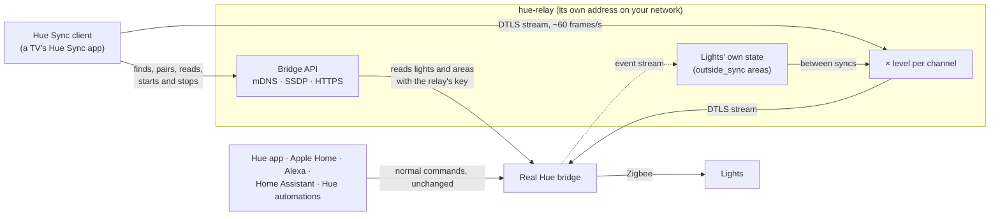
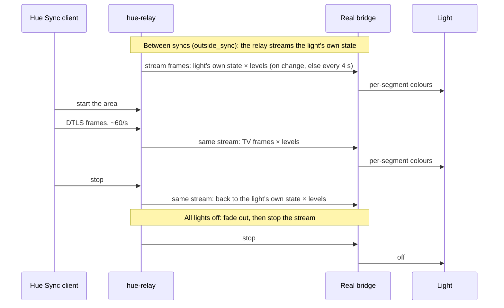

# hue-relay

[](https://github.com/m-torun/hue-relay/actions/workflows/ci.yml)
[](LICENSE)

Per-segment brightness for Philips Hue gradient lights.

> **Use at your own risk.** hue-relay is an independent project, not affiliated with or endorsed by
> Signify (Philips Hue) or LG. It may affect your devices' warranty or terms of service, and you are
> responsible for following the laws and regulations where you live. Read the
> [disclaimer](DISCLAIMER.md) before using it.

Hue gives a light strip one brightness for its whole length. With Hue Sync each segment gets its own
colour, but there is no way to say "these segments should always be dimmer": for a strip whose end
faces a white wall while the rest faces something dark, say, or a segment that sits closer to the
viewer. hue-relay adds that. You give each channel of an entertainment area a level, such as
`[0.4, 0.3, 0.5, 1, 1, 1, 1.1]`, and the relay applies it:

- **during sync**, to the colours a Hue Sync client streams (a TV's Hue Sync app, for one), and
- **between syncs** if you want, to whatever the lights have been set to by the Hue app, Apple Home,
  Alexa, Home Assistant or a Hue automation.

It does nothing else.

## How it works



A Hue Sync client encrypts its stream with a key that only it and its bridge know, so nothing can
change the stream on its way. The relay is therefore the client's bridge: the client pairs with it,
and the relay streams on to the real bridge with a key of its own.

**Between syncs** (areas listed in `outside_sync`), the relay keeps the area streaming and shows
each light's own state (on/off, brightness, colour or colour temperature, gradient) with the
levels applied. The bridge keeps accepting commands for a light while it streams and announces them
on its event stream, so every app goes on controlling the light as usual; only what the light shows
goes through the relay. Frames go out when something changes (fading over about 0.4 s) and otherwise
every 4 s: a light holds the last frame while the session lives, and the bridge ends a session after
10 s without frames. When all lights of the area are off, the relay fades out and ends the stream.



## Requirements

- A Hue Bridge (square, v2) and a Hue Sync client that works with it.
- A machine on the same network that can give the relay **its own IP address** (see next section).
- A Hue entertainment area containing the light(s), made in the Hue app.

## Why the relay needs its own address

To a Hue Sync client the relay must look like a separate bridge: it is found by mDNS and spoken to on
**TCP 80, TCP 443 and UDP 2100**. If the machine you run it on already uses port 80 or 443 for
something else on all its addresses (a web server, Pi-hole, Home Assistant add-ons...), the relay
cannot share them. The relay listens only on its own `relay_ip`, so it needs an address that nothing
else on the machine listens on. Two ways to get one:

### Option 1: Docker with a macvlan network (recommended on a busy server)

macvlan gives the container its own IP and MAC address on your LAN, so to the network it is a
separate device, and nothing on the host has to change.

```
docker network create -d macvlan --subnet 192.168.1.0/24 --gateway 192.168.1.1 -o parent=eth0 lan
docker build -t hue-relay .
docker run -d --name hue-relay --restart unless-stopped \
  --network lan --ip 192.168.1.250 --mac-address 02:00:00:00:00:01 \
  -v $PWD/config.json:/app/config.json:ro \
  -v $PWD/hue-entertainment.json:/secrets/hue-entertainment.json:ro \
  -v $PWD/data:/data hue-relay
```

Use your own subnet, gateway, interface and a free address outside your router's DHCP pool. A known
limitation of macvlan: the host itself cannot reach the container's address (other machines can),
so run test commands from another machine or another container on `lan`.

### Option 2: run the binary directly

On a machine where ports 80 and 443 are free on the address you choose (a Raspberry Pi doing
nothing else, for instance), or after adding a second address to its network interface:

```
cargo build --release
sudo install target/release/hue-relay /usr/local/bin/
```

and a systemd unit such as:

```ini
[Unit]
Description=hue-relay
After=network-online.target
Wants=network-online.target

[Service]
ExecStart=/usr/local/bin/hue-relay run --config /etc/hue-relay/config.json
DynamicUser=yes
StateDirectory=hue-relay
AmbientCapabilities=CAP_NET_BIND_SERVICE
Restart=on-failure

[Install]
WantedBy=multi-user.target
```

with `"data_dir": "/var/lib/hue-relay"` in the config. `CAP_NET_BIND_SERVICE` lets it use ports 80
and 443 without running as root. If you add a second address to an interface, make sure services
that listen on "all addresses" (0.0.0.0) on ports 80 or 443 are changed to listen only on the
machine's main address, or the relay cannot bind.

## Setup

1. **A key for the real bridge.** Press the bridge's link button when asked:

   ```
   hue-relay pair-bridge 192.168.1.10 > hue-entertainment.json
   ```

   (With Docker: `docker run --rm --network host hue-relay pair-bridge 192.168.1.10`.)

2. **Find your area and its channels:**

   ```
   hue-relay list-areas --bridge 192.168.1.10 --key-file hue-entertainment.json
   ```

   shows each area's id and, per channel, the light and where along it the channel sits.

3. **Write `config.json`** (start from `config.example.json`):

   | Key | Meaning |
   |---|---|
   | `relay_ip`, `relay_mac` | the relay's own address; its bridge id is derived from the MAC |
   | `name` | the bridge name clients show |
   | `real_bridge` | the real bridge's address |
   | `key_file` | the file from step 1 |
   | `data_dir` | paired clients, the certificate, `gains.json` |
   | `link_open` | accept new pairings; turn off once your clients are paired |
   | `gains` | per area id, a level per channel id (1 = unchanged, 0 = off) |
   | `outside_sync` | area ids whose levels should also apply between syncs |

4. **Run it** (above), then in the Hue Sync client choose the bridge with your `name`, pair, and pick
   the area. Then set `link_open` to false and restart.

5. **Tune the levels live:** a `gains.json` in `data_dir`, in the same shape as `gains`, overrides the
   config within half a second while it exists. `hue-relay stream-test` streams a steady pattern or
   colours to an area (`--levels` previews levels, `--interval` slows the frames down); it takes the
   area from any client streaming to it.

## What a client sees, and things worth knowing

- mDNS `_hue._tcp` and SSDP answers like a real bridge; the real bridge's v1 and CLIP v2 resources,
  read live, under the relay's bridge id and name.
- A self-signed certificate whose CN is the bridge id, like bridges from before 2019. At least one
  client rejects a chain to a made-up CA (TLS alert `unknown_ca`) but accepts this.
- The DTLS PSK identity may be the username or the application id from `GET /auth/v1`.
- Its own stream as the area's `active_streamer`, in replies and in the event stream. On the real
  bridge every relayed stream belongs to the relay's key; a client that saw that would report
  "another app is syncing". A stream the relay runs between syncs shows as no stream at all.
- The real bridge accepts an entertainment `stop` from any application, for another's stream too; the
  relay only stops streams it started. After a stream is stopped the bridge turns the area's lights
  off.
- One client per area at a time; a newer client takes over. A client silent for 15 s loses its turn.
- Between syncs, Hue effects and dynamic scenes show as their base colour while the relay streams,
  and the Hue app may label the light as syncing.
- Switching a light on between syncs shows its plain (equal-segment) state for a fraction of a second
  before the relay's stream takes over: the bridge applies the command before the stream starts.
- When the relay shuts down normally it ends its streams and switches back on the lights it was
  showing as on, so they keep their own state (with equal segments) until it is back. If it crashes,
  the bridge ends the session within about 10 s and turns the area's lights off.

## Building and testing

`cargo build --release` gives one binary, `target/release/hue-relay`; `cargo test` runs the unit
tests. `docker build -t hue-relay .` builds a small image (the binary on a distroless base).

## Contributing

Issues and pull requests are welcome; see [CONTRIBUTING.md](CONTRIBUTING.md) for the scope, how to
build and test, and how to write commits. Everyone taking part follows the
[Code of Conduct](CODE_OF_CONDUCT.md). Report security problems privately as described in
[SECURITY.md](SECURITY.md). Changes are listed in [CHANGELOG.md](CHANGELOG.md).

## License and disclaimer

Copyright (C) 2026 the hue-relay authors.

hue-relay is free software: you can redistribute it and/or modify it under the terms of the GNU
Affero General Public License as published by the Free Software Foundation, either version 3 of the
License, or (at your option) any later version. In short: you may use, study, change and share it,
and anyone who shares a changed version, or lets others use a changed version over a network, must
publish their source under the same terms. See [LICENSE](LICENSE) for the full text.

It comes with no warranty of any kind and no liability; see the [disclaimer](DISCLAIMER.md) and
sections 15 and 16 of the license. Philips Hue and Hue Sync are trademarks of Signify; LG and webOS
are trademarks of LG Electronics; they are used only to describe what hue-relay works with.
